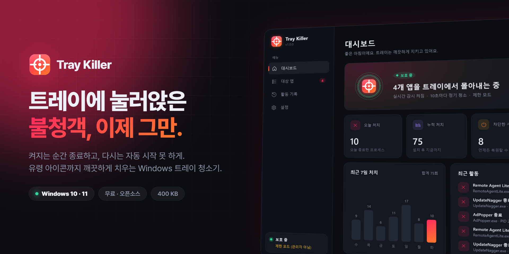
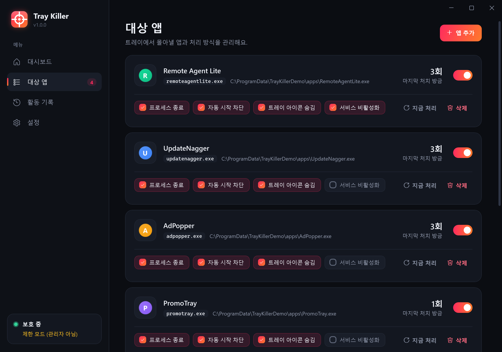
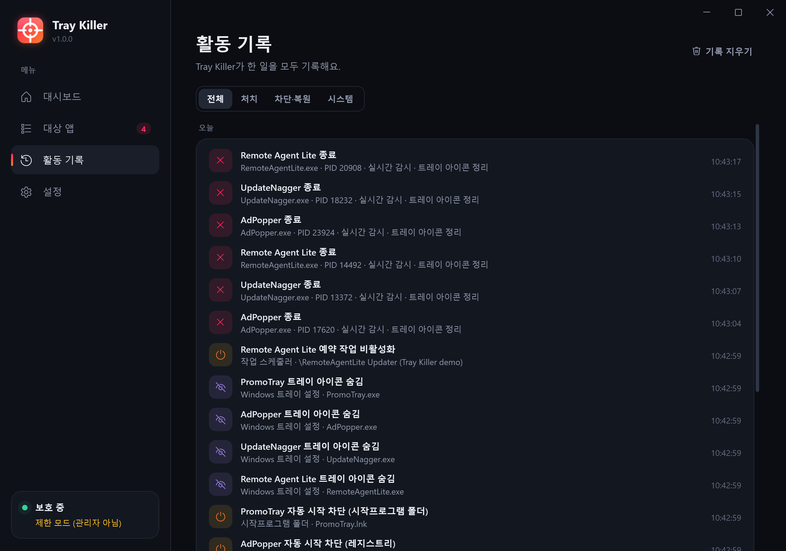
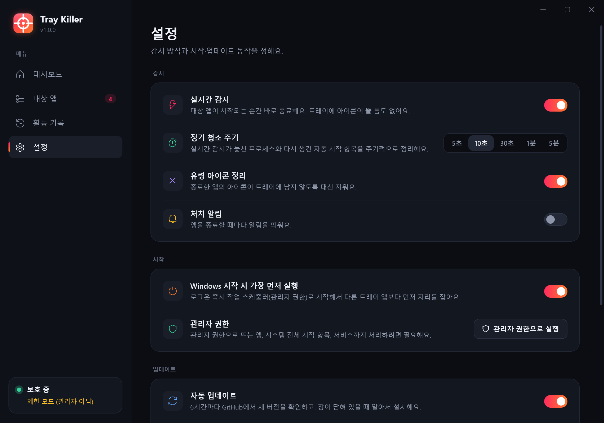
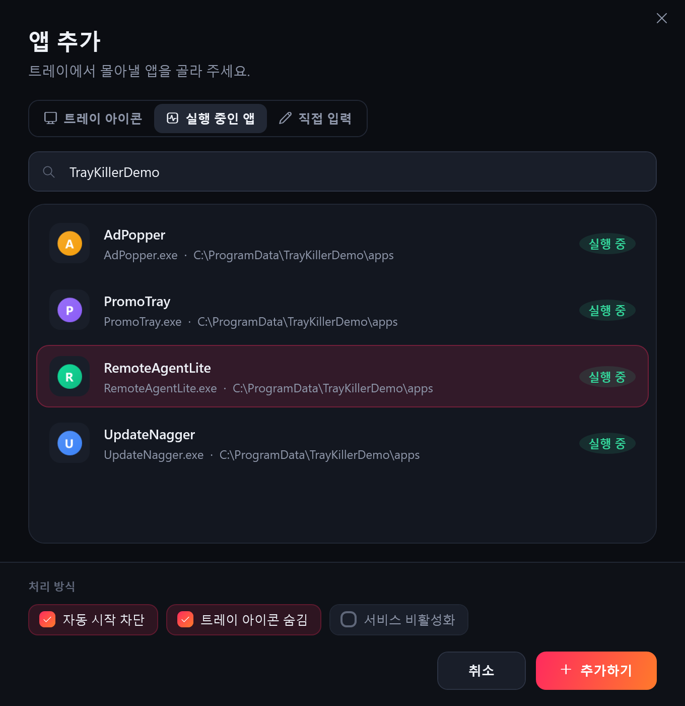

<div align="center">



<br/>

# Tray Killer

**Unwanted tray apps? Gone — and they stay gone.**<br/>
A tiny Windows tray guardian that kills chosen apps the instant they start and switches off every way they auto-start.

[](https://github.com/jeiel85/tray-killer/releases/latest)
[](https://github.com/jeiel85/tray-killer/releases)
[](#-install)
[](LICENSE)

[**⬇ Download**](https://github.com/jeiel85/tray-killer/releases/latest/download/TrayKiller.exe) &nbsp;·&nbsp;
[**🌐 Website**](https://jeiel85.github.io/tray-killer/) &nbsp;·&nbsp;
[**한국어**](README.md)

</div>

---

## Why?

You install one program and it quietly drops a remote-support agent into your tray.
You disable it in Task Manager — it's back tomorrow. You right-click the icon — nothing happens.

**Tray Killer** hunts those apps down for good:

- Kills them **the moment they start**, before they can even show an icon.
- **Switches off auto-start** in the registry, Startup folders, Task Scheduler and services. It does it again if the app re-registers itself.
- Wipes the **ghost icon** a force-killed app leaves behind.
- Starts **before every other tray app** at logon.

<div align="center"></div>

## Features

| | Feature | Details |
|:-:|---|---|
| ⚡ | **Real-time watch** | Kernel-backed `Win32_ProcessStartTrace` events when elevated (1 s WMI polling otherwise). |
| 🧹 | **Periodic sweeps** | Every 5 s – 5 min: catches anything missed and re-created startup entries. |
| 🚫 | **Auto-start blocking** | `Run`/`RunOnce` (HKCU, HKLM, WOW6432Node, Policies), Startup folders, Task Scheduler, Windows services. |
| ♻️ | **One-click restore** | Every change is backed up. Restored items are never touched again. |
| 👻 | **Ghost icon cleanup** | Sends `NIM_DELETE` on the target's behalf right before and after killing it. |
| 🙈 | **Hide tray icons** | Pushes target icons into the Windows 11 overflow area. |
| 🏁 | **Starts first** | Elevated Task Scheduler logon task, so it isn't held back by Explorer's startup delay. |
| 🔄 | **Self-updating** | Checks GitHub Releases every 6 h, verifies SHA-256, swaps itself and restarts. |
| 🛡️ | **Guard rails** | Core Windows processes (`explorer.exe`, `svchost.exe`, `csrss.exe`, …) can't be targeted, not even by wildcard. |
| 🌏 | **Korean / English UI** | Follows Windows, switchable in Settings. |

## Screenshots

| Targets | Activity |
|---|---|
|  |  |
| **Settings** | **Add an app** |
|  |  |

> Screenshots show the real, running app pointed at harmless demo apps staged with [`tools/stage-demo.ps1`](tools/stage-demo.ps1). The UI shown is Korean; English is built in.

## Install

1. [**Download TrayKiller.exe**](https://github.com/jeiel85/tray-killer/releases/latest/download/TrayKiller.exe) (~400 KB).
2. Run it and approve **one UAC prompt**. It installs to `%LOCALAPPDATA%\Programs\TrayKiller` and registers itself in the Start menu and Apps list.
3. Click **Add app** and pick what you want gone.

Requires Windows 10 1903+ or Windows 11. It runs on .NET Framework 4.8, which ships with Windows, so there's nothing else to install.
Uninstall from *Settings → Uninstall* or *Windows Settings → Apps*. Everything it blocked is restored.

## Build

Visual Studio 2022 or Build Tools with the *.NET desktop development* workload.

```powershell
.\build.ps1 -Version 1.0.0          # → dist\TrayKiller.exe + .sha256
.\tools\stage-demo.ps1 -SeedHistory # try it safely against fake tray apps (-Cleanup to remove)
```

Pushing a `v*.*.*` tag builds and publishes a release through GitHub Actions.

## License

[MIT](LICENSE) © 2026 jeiel85
