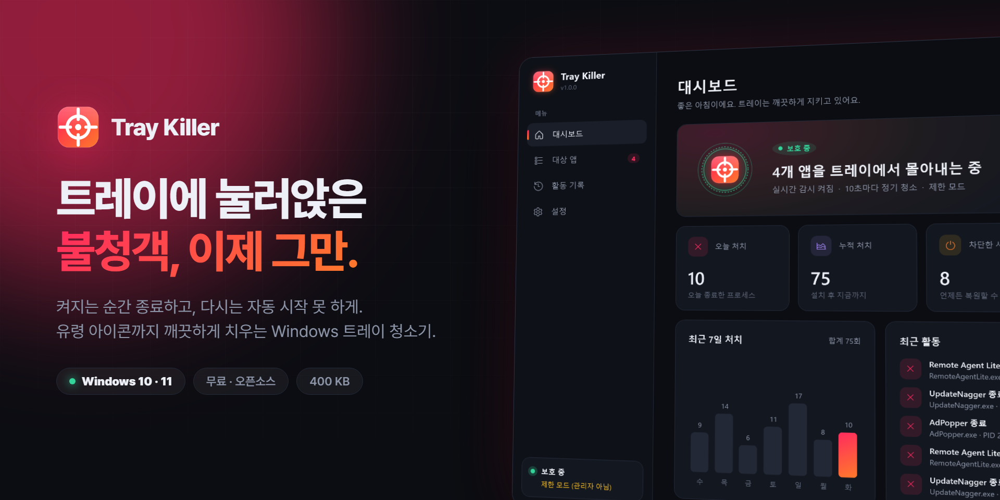
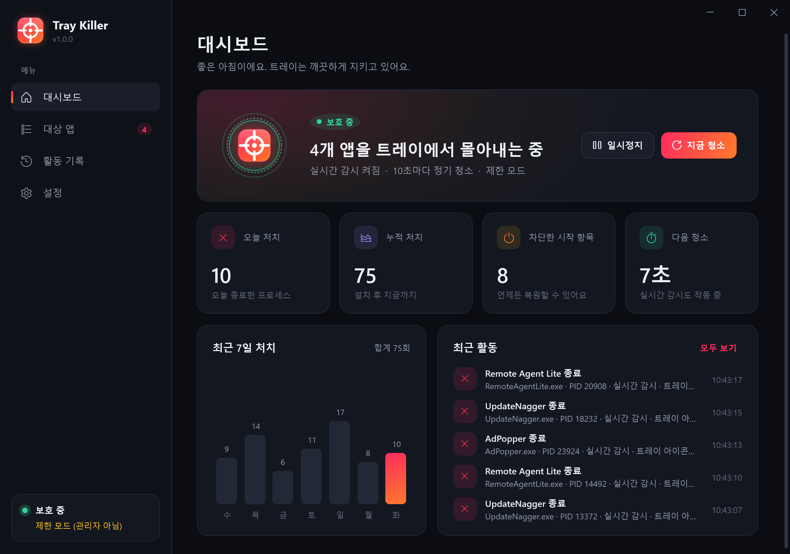
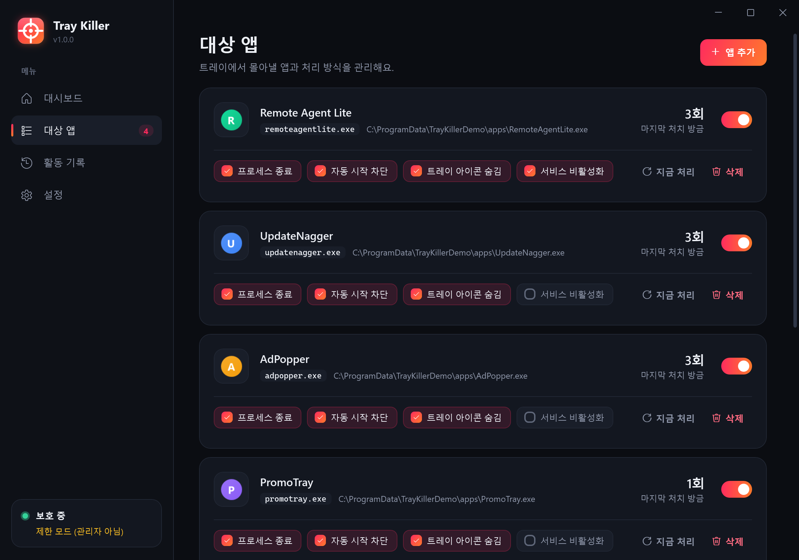
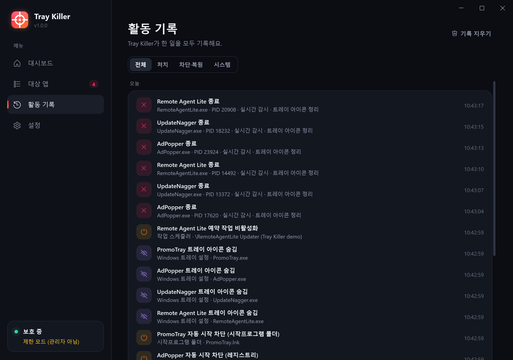
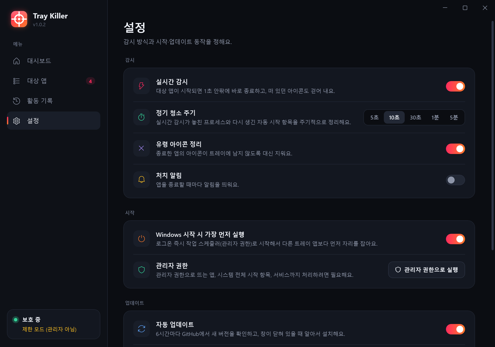
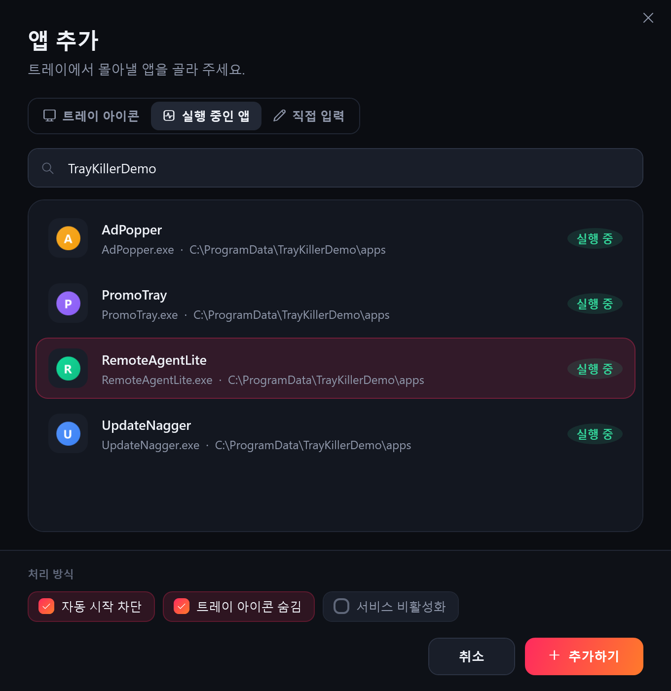
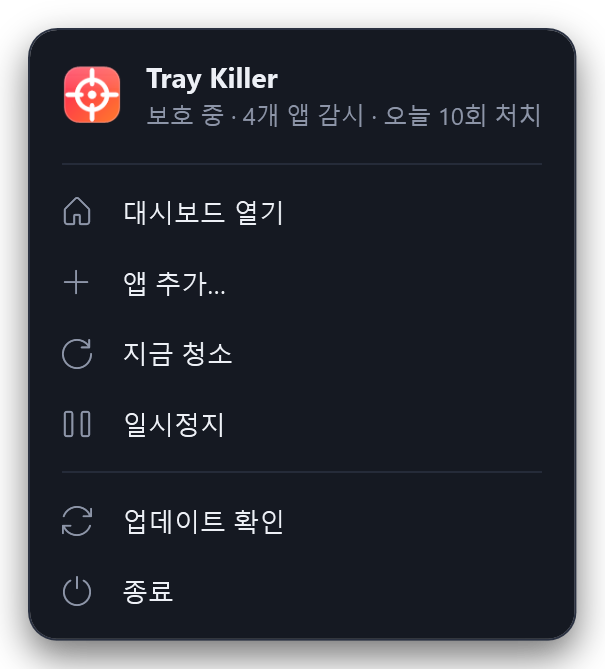
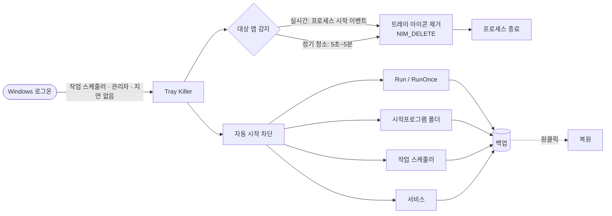

<div align="center">



<br/>

# Tray Killer

**트레이에 눌러앉은 불청객, 이제 그만.**<br/>
지정한 앱을 켜지는 순간 종료하고, 다시는 자동 시작하지 못하게 막는 Windows 트레이 청소기.

[](https://github.com/jeiel85/tray-killer/releases/latest)
[](https://github.com/jeiel85/tray-killer/releases)
[](#-설치)
[](#-faq)
[](LICENSE)

[**⬇ 다운로드**](https://github.com/jeiel85/tray-killer/releases/latest/download/TrayKiller.exe) &nbsp;·&nbsp;
[**🌐 소개 페이지**](https://jeiel85.github.io/tray-killer/) &nbsp;·&nbsp;
[**English**](README.en.md)

</div>

---

## 😤 이런 적 있으시죠?

어떤 프로그램을 설치했더니 **원격 지원 에이전트 같은 게 딸려 와서 트레이에 자리를 잡았습니다.**
작업 관리자에서 시작 프로그램을 꺼도 다음 날 또 살아나고, 아이콘은 우클릭조차 안 되죠.

**Tray Killer**는 그런 앱을 한 번 지정해 두면 끝까지 쫓아냅니다.

- 켜지면 **1초 안팎에** 종료합니다. 아이콘이 떠도 곧바로 걷어 냅니다.
- 레지스트리·시작프로그램 폴더·작업 스케줄러·서비스에서 **자동 시작을 끕니다.** 앱이 다시 등록해도 또 끕니다.
- 강제 종료하면 남는 **유령 아이콘까지** 대신 지웁니다.
- 로그온하자마자 **다른 어떤 트레이 앱보다 먼저** 자리를 잡습니다.

<div align="center">

</div>

## ✨ 기능

| | 기능 | 설명 |
|:-:|---|---|
| ⚡ | **실시간 감시** | 관리자 모드에서는 커널 프로세스 이벤트(`Win32_ProcessStartTrace`)로 시작 즉시 감지하고 바로 종료합니다. |
| 🧹 | **정기 청소** | 5초~5분 주기로 놓친 프로세스와 되살아난 시작 항목을 다시 정리합니다. |
| 🚫 | **자동 시작 차단** | `Run`/`RunOnce`(HKCU·HKLM·WOW6432Node·Policies), 시작프로그램 폴더, 작업 스케줄러, Windows 서비스까지 막습니다. |
| ♻️ | **원클릭 복원** | 끈 항목은 모두 백업합니다. 버튼 하나로 원래대로 돌리고, 복원한 항목은 다시 건드리지 않습니다. |
| 👻 | **유령 아이콘 제거** | 종료 직전과 직후에 대상 앱의 트레이 아이콘을 대신 지워(`NIM_DELETE`) 빈 아이콘이 남지 않습니다. |
| 🙈 | **트레이 아이콘 숨김** | Windows 11 트레이 설정에서 대상 앱 아이콘을 숨김 영역으로 보냅니다. |
| 🏁 | **가장 먼저 시작** | 관리자 권한 작업 스케줄러 로그온 작업으로 시작하므로, 시작 지연이 걸리는 일반 시작프로그램보다 앞섭니다. |
| 🔄 | **자동 업데이트** | 6시간마다 GitHub Releases를 확인하고, SHA-256을 검증한 뒤 스스로 교체·재시작합니다. |
| 🛡️ | **안전장치** | `explorer.exe`, `svchost.exe`, `csrss.exe` 같은 Windows 핵심 프로세스는 와일드카드로도 지정할 수 없습니다. |
| 🌏 | **한국어 / English** | Windows 언어를 따라가고, 설정에서 바꿀 수 있습니다. |

## 📸 스크린샷

<table>
  <tr>
    <td width="50%"><br/><sub><b>대상 앱</b>: 앱별로 종료·자동 시작 차단·아이콘 숨김·서비스 비활성화를 고릅니다</sub></td>
    <td width="50%"><br/><sub><b>활동 기록</b>: 무엇을, 언제, 어떻게 처리했는지 남김없이 기록합니다</sub></td>
  </tr>
  <tr>
    <td width="50%"><br/><sub><b>설정</b>: 실시간 감시, 청소 주기, 시작 방식, 자동 업데이트</sub></td>
    <td width="50%"><br/><sub><b>앱 추가</b>: 트레이 아이콘·실행 중인 앱에서 고르거나 직접 입력합니다</sub></td>
  </tr>
</table>

<p align="center"><br/><sub>트레이 아이콘을 우클릭하면 나오는 메뉴</sub></p>

> 스크린샷은 저장소의 [`tools/stage-demo.ps1`](tools/stage-demo.ps1)로 띄운 **데모 앱**(가짜 트레이 앱)을 대상으로, 실제로 실행 중인 Tray Killer 화면을 그대로 렌더링한 것입니다.

## 🧠 동작 원리



1. **설치하면 UAC 한 번**으로 `C:\Program Files\TrayKiller`에 복사되고, *가장 높은 권한으로 실행*되는 로그온 작업이 등록됩니다. 이후에는 프롬프트 없이 관리자 권한으로 뜹니다.
2. 로그온 트리거는 Explorer의 시작프로그램 지연보다 먼저 실행되고, 처음 1분은 우선순위를 *보통 이상*으로 올려 경쟁에서 이깁니다.
3. 관리자 모드에서는 커널 기반 `Win32_ProcessStartTrace` 이벤트로 프로세스 시작을 감지합니다. 관리자 권한이 없으면 1초 간격 WMI 폴링으로 대신합니다.
4. 종료하기 전에 대상 프로세스의 창 핸들로 `Shell_NotifyIcon(NIM_DELETE)`를 보내 아이콘을 먼저 걷어 냅니다. 강제 종료된 앱은 아이콘을 직접 지우지 못하기 때문입니다.
5. 차단한 항목은 `blocked.json`에 원래 값 그대로 백업합니다. 대상을 삭제하거나 앱을 제거하면 모두 복원합니다.

## 📦 설치

1. [**TrayKiller.exe 다운로드**](https://github.com/jeiel85/tray-killer/releases/latest/download/TrayKiller.exe) (약 400 KB)
2. 실행한 뒤 **UAC에서 "예"** 를 한 번 누르면 설치, 시작 메뉴 등록, 자동 시작 등록이 끝납니다.
3. **앱 추가**에서 트레이에서 치우고 싶은 앱을 고르면 끝입니다.

- 요구 사항: Windows 10 1903 이상 또는 Windows 11. .NET Framework 4.8은 Windows에 이미 들어 있어서 따로 설치할 게 없습니다.
- 제거: *설정 → 제거* 또는 *Windows 설정 → 앱*. 차단했던 항목은 모두 원래대로 복원됩니다.
- 설치 위치: `C:\Program Files\TrayKiller`
- 데이터 위치: `C:\ProgramData\TrayKiller\<사용자 SID>` (설정, 활동 기록, 백업, 로그). 관리자만 쓸 수 있고 사용자는 읽기만 가능합니다.

## 🔒 보안 설계

Tray Killer는 관리자 권한으로 상주하기 때문에, **일반 권한 프로그램이 이 앱을 발판 삼아 권한을 올릴 수 없도록** 설계했습니다.

- **실행 파일은 관리자 전용 폴더에.** 관리자 권한 로그온 작업이 실행하는 exe는 `Program Files`에 두어 일반 권한으로는 바꿔치기할 수 없습니다. (v1.0.x는 사용자 폴더에 설치됐고, v1.1.0이 자동으로 옮깁니다.)
- **설정·복원 데이터는 관리자 전용 저장소에.** 복원 데이터는 레지스트리 쓰기나 서비스 변경 같은 관리자 작업을 일으키므로 `ProgramData`의 잠긴 폴더에 둡니다. 폴더가 미리 만들어져 있거나 링크로 바꿔치기돼 있으면 신뢰하지 않고 치워 둡니다.
- **복원 전에 다시 검증.** 저장된 값이 무엇이든 Tray Killer가 원래 차단하는 위치(Run 키, 시작프로그램, 트레이 설정 등)만 되돌립니다.
- **사용자 쓰기 가능 경로에서는 파일을 옮기지 않음.** 사용자 시작프로그램 폴더 항목은 작업 관리자와 같은 `StartupApproved` 플래그로 끄고, 정리할 때도 정션이나 심볼릭 링크를 따라가지 않습니다.
- **최소 권한.** 명령 채널은 현재 사용자만 열 수 있고, 다른 사용자 세션의 프로세스는 건드리지 않습니다. `SeDebugPrivilege`는 꼭 필요한 순간에만 켜고, 브라우저나 폴더는 관리자 권한이 아닌 일반 권한으로 엽니다.
- **업데이트 검증.** 이 저장소의 릴리스 다운로드 URL만 허용하고, SHA-256과 파일 버전이 모두 맞아야 교체합니다.

취약점은 [SECURITY.md](SECURITY.md)의 방법으로 비공개 제보해 주세요.

## ❓ FAQ

<details>
<summary><b>엉뚱한 프로그램을 죽이면 어떡하죠?</b></summary>

Tray Killer는 사용자가 지정한 실행 파일 이름(와일드카드 가능)만 건드립니다. `explorer.exe`, `svchost.exe`, `lsass.exe`, `csrss.exe`, `winlogon.exe` 등 Windows 핵심 프로세스는 보호 목록에 있어서 대상으로 넣을 수 없습니다. 자동 시작 항목은 지우지 않고 **백업한 뒤 끄기** 때문에 언제든 복원할 수 있습니다.
</details>

<details>
<summary><b>관리자 권한이 꼭 필요한가요?</b></summary>

없어도 동작합니다(제한 모드). 다만 관리자 권한으로 실행되는 앱을 종료하거나, `HKLM` 시작 항목, 다른 계정이 만든 예약 작업, 서비스를 끄려면 관리자 권한이 필요합니다. 처음에 UAC를 한 번 승인하면 이후에는 작업 스케줄러가 프롬프트 없이 관리자 권한으로 실행해 줍니다.
</details>

<details>
<summary><b>자동 업데이트는 안전한가요?</b></summary>

이 저장소의 GitHub Releases에서만 받습니다. 릴리스마다 함께 올라가는 `TrayKiller.exe.sha256`과 해시가 일치해야 교체합니다. 창을 열어 둔 동안에는 자동으로 교체하지 않습니다. 설정에서 끌 수도 있습니다.
</details>

<details>
<summary><b>왜 .NET Framework인가요?</b></summary>

상주 앱에는 *안정성*과 *빠른 시작*이 가장 중요합니다. .NET Framework 4.8은 Windows 10/11에 기본으로 들어 있고 Windows Update로 관리됩니다. 그래서 런타임을 따로 설치할 필요가 없고, exe 하나가 400 KB 남짓이며, 로그온 직후에도 바로 뜹니다. UI는 WPF, 시스템 연동은 Win32 API·WMI·작업 스케줄러로 구현했습니다.
</details>

<details>
<summary><b>트레이 아이콘이 '숨김' 영역에 들어가요.</b></summary>

Windows 11은 새 트레이 아이콘을 기본적으로 숨깁니다. Tray Killer는 처음 실행할 때 자기 아이콘을 표시 영역으로 한 번 옮겨 둡니다. 사용자가 직접 바꾼 설정은 건드리지 않습니다.
</details>

## 🛠️ 직접 빌드하기

Visual Studio 2022(또는 Build Tools)의 *.NET 데스크톱 개발* 워크로드가 필요합니다.

```powershell
git clone https://github.com/jeiel85/tray-killer.git
cd tray-killer
.\build.ps1 -Version 1.0.0          # → dist\TrayKiller.exe + .sha256
.\tools\stage-demo.ps1 -SeedHistory # 데모 앱으로 안전하게 체험 (정리: -Cleanup)
```

- 릴리스: `v*.*.*` 태그를 푸시하면 GitHub Actions가 빌드하고 릴리스를 만듭니다([`release.yml`](.github/workflows/release.yml)).
- 프로젝트 구조: `src/TrayKiller/Core` (엔진: 감시·차단·복원·업데이트), `src/TrayKiller/UI` (WPF 화면), `docs/` (소개 페이지), `tools/` (아이콘 생성기·데모 스크립트)

## 📄 라이선스

[MIT](LICENSE) © 2026 jeiel85
